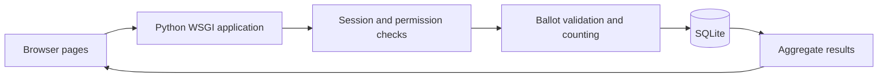

# Design and acceptance / 设计与验收

## Architecture

The three responsibilities are pages, application rules and storage. They are currently kept in one small application module to make the increment easy to run; later refactoring can separate routes and services. `schema.sql` defines the data model, and `test_app.py` exercises the application interface. Technical selection remains subject to team review.

## Important decisions / 难点逐项解释

1. **未选和零分不同。**0是合法分数，空白不是；每位候选人都要评分。不能把空白自动补成0，否则会改变投票者的意思。
2. **不能只把按钮变灰。**后端检查活动是否开放、是否截止、是否已投、候选人是否属于该活动。即使直接构造请求，也要拒绝非法票。
3. **整张票一起保存。**先开启事务，再检查和写入。中间任何一步失败都回滚，避免出现“已经投过但选项没存完”。同一轮用户唯一约束是第二层保护。
4. **按轮次防重复。**rounds和ballots保存轮次。当前只有第一轮；之后实现决选时新增轮次，不覆盖旧票。不要声称第二轮功能已实现。
5. **结束和发布是两件事。**关闭后不能投票，但结果未必公开。当前演示里创建者先看，再发布；私人结果即使发布也不会向普通用户开放。正式审批权限还要开会确定。
6. **分表不等于匿名。**ballots记录参与者，choices记录选项，二者仍可在数据库内关联。UI只显示汇总，不声称密码学匿名。
7. **截止检查和定时任务不同。**即使页面没有刷新，提交时也按服务器时间拒绝过期票。没有请求时数据库状态暂未刷新；后台任务属于后续工作。
8. **星星只是输入方式。**每组radio代表某位候选人的0–5分；没有默认选中项。明确的零分入口避免误操作。

## Traceability

| Requirement / 需求 | Implementation / 实现 | Acceptance evidence / 验收 |
|---|---|---|
| Preview records no vote | draft preview + server-side status check | preview cannot submit; ballot count remains zero |
| Single choice only | candidate membership + one scalar value | foreign candidate and repeated values rejected |
| Explicit 0–5 rating for all | per-candidate score validation | zero accepted; missing, decimal and score 6 rejected |
| One ballot per round | service check + UNIQUE(round_id,user_id) | repeated submission leaves one ballot |
| Reject after deadline | server timestamp check under transaction | expired event rejects new ballot |
| No partially saved ballot | one transaction for ballot and choices | injected choice failure leaves both tables empty; retry succeeds |
| Results access | closure + publication + owner checks | private result denied to ordinary voter after publication |
| Creator lifecycle authority | server checks creator_id | other voter cannot open or close event |

Open settings such as identity verification, extension timing and final publication roles stay outside confirmed implementation claims. Award and tie rules from meetings are agreed requirements but not implemented by this increment.
